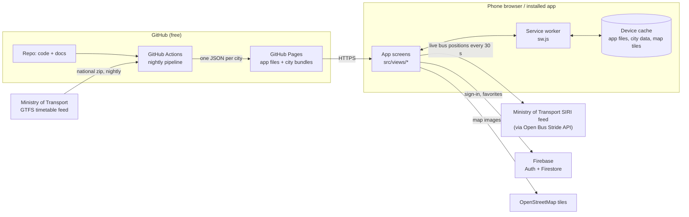

# Architecture

Knight Bus is a **static web app** with no server of our own. The phone downloads the app
files once and then talks to three outside services directly.

## The parts

| Part | What it does | Code | Doc |
|------|--------------|------|-----|
| App shell | The page, the screen router, start-up | [index.html](../index.html), [src/app.js](../src/app.js) | [user-flows.md](user-flows.md) |
| Screens | Sign-in, choose city, menu, editor, commute | [src/views/](../src/views/) | [user-flows.md](user-flows.md) |
| Accounts | Email and Google sign-in through Firebase Auth | [src/auth.js](../src/auth.js) | [ADR-0004](adr/0004-firebase.md) |
| Favorites storage | Saves favorites per user in Firestore | [src/store.js](../src/store.js), [firestore.rules](../firestore.rules) | [data-model.md](data-model.md#favorite) |
| Location | GPS and choosing the city | [src/location.js](../src/location.js) | [user-flows.md](user-flows.md#1-first-launch) |
| City data | Downloads and caches one city's bundle | [src/cityData.js](../src/cityData.js) | [data-model.md](data-model.md#city-bundle) |
| Map | Leaflet map, stops, user dot, bus icons, flags, map key | [src/map.js](../src/map.js) | this file |
| Line geometry | Positions along a line, incoming/outbound split, "5 min before the stop" | [src/lib/routeGeometry.js](../src/lib/routeGeometry.js) | [user-flows.md](user-flows.md#4-using-a-favorite) |
| Side-by-side lines | Shifted lines without knots, recomputed per zoom | [src/lib/offsetLine.js](../src/lib/offsetLine.js) | [ADR-0007](adr/0007-address-search.md) |
| Draggable panel | Bottom panel you drag for more map or more list | [src/lib/sheetDrag.js](../src/lib/sheetDrag.js) | [user-flows.md](user-flows.md#4-using-a-favorite) |
| Usage insights | Consent, safe events, debug-only details | [src/analytics.js](../src/analytics.js), [src/views/privacy.js](../src/views/privacy.js) | [privacy.md](privacy.md) |
| Extra line sources | Weekend lines outside the government feed | [pipeline/sources/](../pipeline/sources/) | [data-pipeline.md](data-pipeline.md#weekend-lines-outside-the-government-feed) |
| Address search | Start point / destination search, street names for tapped points | [src/geocode.js](../src/geocode.js) | [ADR-0007](adr/0007-address-search.md) |
| Live lines | Draws chosen lines and their live buses | [src/liveLines.js](../src/liveLines.js), [src/realtime.js](../src/realtime.js) | [realtime.md](realtime.md) |
| Offline | Caches app files and map tiles | [sw.js](../sw.js) | [#offline](#offline) |
| Install | Name, icon, full-screen mode | [manifest.webmanifest](../manifest.webmanifest), [icons/](../icons/) | [ADR-0001](adr/0001-pwa.md) |
| Data pipeline | National GTFS → one small file per city | [pipeline/](../pipeline/) | [data-pipeline.md](data-pipeline.md) |
| Deploy | Builds main + debug, publishes to GitHub Pages | [.github/workflows/deploy.yml](../.github/workflows/deploy.yml), [scripts/build-site.sh](../scripts/build-site.sh) | [release-process.md](release-process.md) |
| Updates | Detects new versions, offers *Update* | [src/updates.js](../src/updates.js), [src/build.js](../src/build.js) | [release-process.md](release-process.md#what-users-see-when-you-release) |

## The app

The app uses **plain JavaScript modules** with no framework and no build step. The browser loads
`src/app.js`, and it imports everything else. The benefit is that any file in the repo is
exactly what runs on the phone. The cost is that we write a little more DOM code by hand
(see [src/lib/dom.js](../src/lib/dom.js)).

The URL hash picks the screen:

| Hash | Screen | File |
|------|--------|------|
| `#/login` | Sign in / create account | [views/login.js](../src/views/login.js) |
| `#/city` | Choose metropolitan area | [views/city.js](../src/views/city.js) |
| `#/menu` | Main menu, three favorites | [views/menu.js](../src/views/menu.js) |
| `#/privacy` | Privacy notice, usage-sharing switch | [views/privacy.js](../src/views/privacy.js) |
| `#/edit/1` … `#/edit/3` | Edit a favorite | [views/editor.js](../src/views/editor.js) |
| `#/commute/1` … `#/commute/3` | Use a favorite | [views/commute.js](../src/views/commute.js) |

`app.js` checks the guards first: no user → login; no city → city picker. Each screen's
`render()` function returns a cleanup function, which stops timers and removes the map
when you leave the screen.

## Accounts

Firebase Auth handles passwords, Google sign-in, password reset and keeping the user signed
in. When `src/config.js` still has placeholder values, the app runs in **local demo mode**:
there are no accounts, and favorites go to the device's `localStorage`. This lets you try the
app before Firebase is set up.

## Offline

`sw.js` is a service worker. The browser runs it in the background for this site.

- **App files** are cached **per version** (the commit id). The app always opens from its
  own complete copy. A new version downloads whole in the background, then the app offers
  *Update*; otherwise the new version starts at the next cold start. Details:
  [release-process.md](release-process.md#what-users-see-when-you-release).
- **Map tiles** use *cache-first*. The 3,000 most recent tiles are kept.
- **City data** is cached by `src/cityData.js` itself, keyed by version, so it downloads
  only when the pipeline publishes a change.
- **Live data and Firebase** always go to the network.

## Hosting and deployment

GitHub Pages serves the app over HTTPS. Phones need HTTPS for GPS and for installing.
On every push to `main` or `debug`, and every night,
[deploy.yml](../.github/workflows/deploy.yml) builds **both versions** with
[build-site.sh](../scripts/build-site.sh). For each one it:

1. runs the docs check ([ADR-0005](adr/0005-docs-as-code.md)) and the unit tests,
2. downloads the national GTFS feed and builds one bundle per city,
3. stamps the version (commit id, channel) into `src/build.js` and `sw.js`.

`main` is published at the site root; `debug` at `/debug/`, for testing on a phone first.
See [release-process.md](release-process.md).

The city bundles are **not** committed to git (they are large and change daily). They exist
only in the published site.

## Decisions

The reasons behind these choices are in [adr/](adr/):

- [ADR-0001](adr/0001-pwa.md) An installable web app (PWA) instead of a store app
- [ADR-0002](adr/0002-realtime-source.md) Live data through the Open Bus Stride mirror of the government SIRI feed
- [ADR-0003](adr/0003-maps.md) OpenStreetMap raster tiles cached on view, with offline vector maps later
- [ADR-0004](adr/0004-firebase.md) Firebase for accounts and favorites
- [ADR-0005](adr/0005-docs-as-code.md) Docs as code, with requirement IDs checked in CI
- [ADR-0006](adr/0006-release-channels.md) A debug version in a sub-folder of the same site
- [ADR-0007](adr/0007-address-search.md) Address search with OpenStreetMap Nominatim; side-by-side lines
- [ADR-0008](adr/0008-usage-insights.md) Usage insights: consent first, safe data for users, details for debug only
