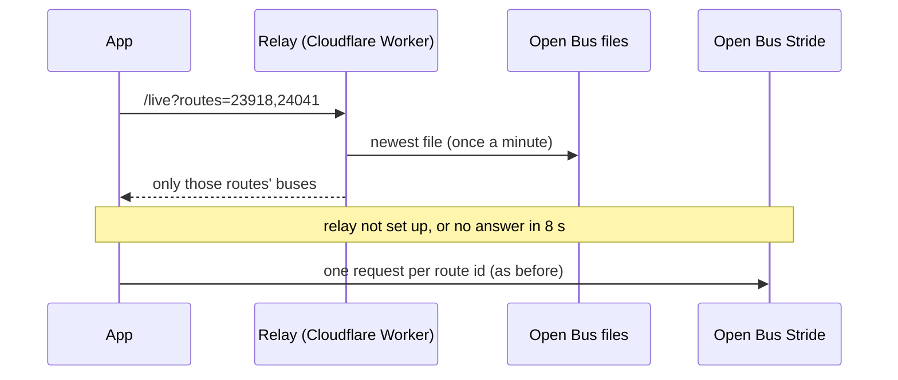

# Live buses

Requirements: REQ-RT-1, REQ-RT-2, REQ-RT-3. Code: [src/realtime.js](../src/realtime.js),
[src/liveLines.js](../src/liveLines.js). Decision: [ADR-0002](adr/0002-realtime-source.md).

## Where the data comes from

Israeli bus operators report every bus position to the **Ministry of Transport SIRI
service**. The government gives direct access only to registered developers, from a fixed
server IP address, so a phone browser cannot call it.

The **Open Bus Stride API** by the Public Knowledge Workshop (Hasadna) reads that government
feed every minute and republishes it as an open, CORS-enabled API. This MVP reads it from the
phone:

```
GET https://open-bus-stride-api.hasadna.org.il/siri_vehicle_locations/list
    ?siri_routes__line_ref=<GTFS route_id>
    &recorded_at_time_from=<now − 30 min>
    &recorded_at_time_to=<now + 2 min>
    &order_by=recorded_at_time desc
    &limit=300
```

The SIRI `LineRef` is the same number as the GTFS `route_id`, so a route from the city bundle
maps straight to its live buses. When this was written, positions were about 1–2 minutes old.

**When the feed runs late** (REQ-RT-9). The mirror loads the ministry's data in batches and
can fall behind: on 2026-10-11 it was 15–25 minutes behind all day. The app therefore asks
for the last 30 minutes, and any position older than 5 minutes is shown with
*⚠ Live data is late: positions are from 17 min ago*. The bus is drawn where it was then;
it has moved on since. This is another reason for REQ-RT-4 (reading the ministry directly).

The upper time bound matters: the feed has some rows with wrong future timestamps (year
2038), and they would otherwise sort first.

## The relay

Stride's delay comes from its loading step, not from the buses (REQ-RT-11,
[ADR-0011](adr/0011-live-relay.md)). The Open Bus project also publishes what it loads
*from*: one file a minute with every bus in the country.

```
https://openbus-stride-public.s3.eu-west-1.amazonaws.com/stride-siri-requester/YYYY/MM/DD/HH/MM.br   (UTC)
```

Each file appears less than a minute after its minute, is about 250 KB packed (brotli) and
4 MB unpacked, and holds about 9,000 bus records in the ministry's own wording. A browser
cannot read it directly, so [relay/worker.js](../relay/worker.js) stands in between:



- **The question:** `GET <relay>/live?routes=<id>,<id>…`, up to 80 route ids. One request
  covers every route on the screen, with all the ids of merged alternatives (REQ-DATA-10).
- **The answer:** `{ snapshot, at, routes: { "<id>": [records…] } }`. `snapshot` is the
  file's minute, `at` the time it was made. The app turns each record into the same bus
  object as a Stride row (`busFromRecord`), so everything after it is unchanged.
- **The file also holds buses last heard long ago.** The app keeps positions from the last
  30 minutes and drops finished rides, exactly as with Stride (REQ-RT-9).
- **Only our app may read the answers from a browser:** the relay allows
  `https://eilonlevin3.github.io` and a developer's `localhost`.
- **Turning it on:** `realtime.relayUrl` in [src/config.js](../src/config.js). Empty means
  Stride only. Putting the relay online: [setup.md](setup.md#6-the-live-relay).
- **Time limits:** 8 seconds for the relay, then Stride; 20 seconds for Stride, then the
  row says *Live data unavailable right now*.

The header `x-relay` on every answer says how the relay got its data (`built`, `cache` or
`memo`) and how long it took, for checking that it runs within Cloudflare's limits.

## What a bus tells us

Tap a bus on any map (REQ-RT-10). The pop-up shows the route, where the bus is relative to
your stop, and:

- **Last signal:** the date and time the bus reported, and how long ago that was. If it is
  more than 5 minutes old, a warning says the bus has moved on since.
- **What the signal says**, in plain words: position, speed (km/h), heading, kilometers
  driven since the trip started, when the trip was scheduled to start, the vehicle number,
  the trip reference, the operator code, how far the position is from the route on our map,
  and the batch the signal arrived in.
- **Everything in the signal, as it was sent:** the raw record, field by field, including
  the fields the feed leaves empty.

The pop-up can be longer than the screen. Its **Close** button stays at the bottom while
the rest scrolls, so it can be closed without scrolling (the same in every pop-up).

Nothing here is about a person: it is public data about a vehicle. Opening the pop-up is
counted as `bus_info_opened` (privacy.md); which bus is not recorded.

Code: [views/busInfo.js](../src/views/busInfo.js), [liveLines.js](../src/liveLines.js).

## The ghost: an estimate of where the bus is now

A bus's last signal is always a little old: about a minute through the relay, much more
when the feed is late. The ghost (REQ-RT-12) shows where the bus has probably got to since.

- **Only on request.** Tap a bus, and in its pop-up press **Show the ghost on the map**.
  It is for that one bus. Tap the bus or its ghost again and press **Remove the ghost**.
- **How it is worked out.** The last signal is placed on the route's path. The time since
  the signal is then spent moving forward along the path at **timetable speed**: the
  scheduled minutes between each pair of stops, spread evenly between them. Where the
  route has no timetable, 18 km/h is used. The ghost never passes the last stop and never
  runs more than 30 minutes ahead.
- **How it looks.** A see-through marker with a dashed edge and a 👻, in the route's color,
  with a dotted trail from the real position to it. It moves every 2 seconds. The real
  marker stays where the last signal was.
- **What it does not know.** Traffic, how long the bus waits at stops, whether it left
  late. It is an estimate, and the pop-up says so. When a new signal arrives, the ghost
  starts again from it.
- If the bus is more than 250 m from the route as our map has it, no ghost is offered.

"Stops away" in the lists still counts from the real signal, not from the ghost.

Code: [liveLines.js](../src/liveLines.js) (`ghostOf`, `drawGhosts`),
[lib/routeGeometry.js](../src/lib/routeGeometry.js) (`advanceOnPath`),
[views/busInfo.js](../src/views/busInfo.js).

## The "next two + last passed" rule

For one route and one chosen stop:

0. A route can report under several ids: its own and those of the alternatives merged into
   it (REQ-DATA-10, [data-pipeline.md](data-pipeline.md#alternatives-one-route-several-entries)).
   The app asks for each and puts the answers together.
1. Fetch the newest position of each ride (`siri_ride__id`) on the route in the last 30
   minutes. Drop rides whose newest position is more than 7 minutes behind the newest
   position on the route: those buses finished their trip.
2. **Place every stop on the route's path** (its shape), walking forward from the
   first stop. This keeps the stops in order even where a route comes back along the same
   street. The result is cached per route.
3. **Place each bus on the path:** take the nearest point on the path. The path is the most
   common stop pattern that passes the chosen stop. A bus is dropped only when it is more
   than 250 m from **every** stop pattern of the route (depot, bad GPS). A bus driving
   another pattern of the route stays, shown where it really is (REQ-RT-8). In a test on 2026-10-09,
   most live buses were within 30 m.
4. `nextStop` = the first stop at or after the bus's position.
   `stopsAway = index of chosen stop − nextStop`. Here 0 means "your stop is its next stop"
   (shown as *arriving*), and −1 means it passed your stop at its last stop.
5. **Next two** = the buses with `stopsAway ≥ 0`, closest first, at most 2.
6. **Last passed** = the bus with the largest negative `stopsAway`, at most 1.

Unit tests: [tests/core.test.mjs](../tests/core.test.mjs) (`npm test`).

On the map, approaching buses are solid and pulse; the passed bus is faded and dashed. Each
popup and panel row shows how old the position is.

When a Favorite Commute has two stops on the same route, one bus can be "passed" for stop 1 and
"next" for stop 2. It gets one marker that shows both facts.

## Refresh

Every 30 seconds (`realtime.refreshMs` in [src/config.js](../src/config.js)) while the screen
is visible. Updates pause when the app goes to the background and resume when it returns.
The app sends one request per route, all in parallel.

## Limits and next steps

- **Loops:** a *bus* is placed at its nearest point on the path. Where a route passes the
  same street twice, the bus can be put on the wrong leg. Using the previous position, or
  the feed's `distance_from_journey_start`, would fix it.
- **No arrival times yet.** REQ-RT-4 (Planned) adds a small proxy, for example a Cloudflare
  Worker, holding a ministry SIRI-SM key. SIRI-SM gives predicted arrival minutes per stop.
- **Third-party dependency.** If Stride is down, the panel says *Live data unavailable* and
  the map still works.
