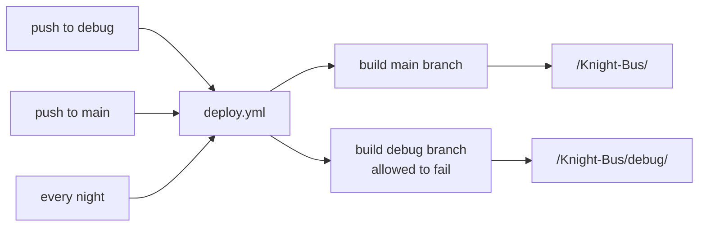
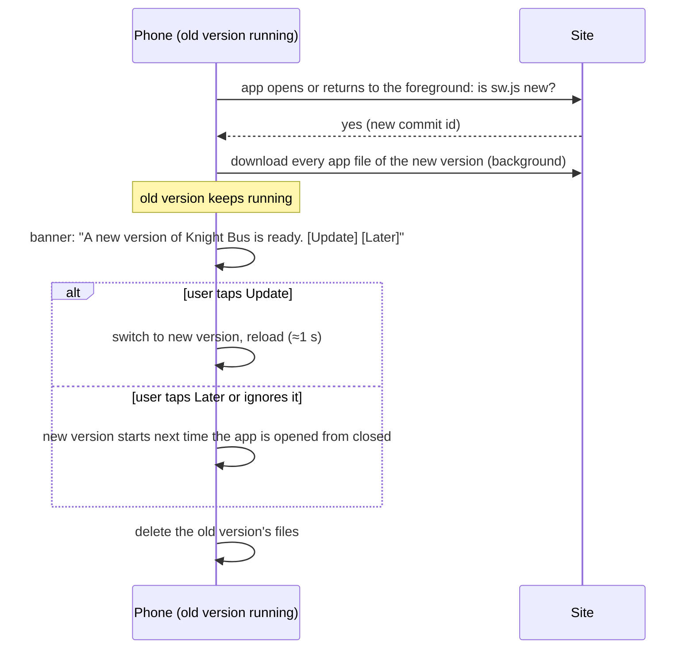

# Release process: test on your phone, then release

Requirements: REQ-REL-1, REQ-REL-2, REQ-REL-3, REQ-PWA-3. Decision: [ADR-0006](adr/0006-release-channels.md).
Code: [.github/workflows/deploy.yml](../.github/workflows/deploy.yml), [scripts/build-site.sh](../scripts/build-site.sh),
[sw.js](../sw.js), [src/updates.js](../src/updates.js), [src/build.js](../src/build.js), [src/config.js](../src/config.js).

## Two versions, two branches

| Branch | Web address | Who it's for | Home-screen app |
|--------|-------------|--------------|-----------------|
| `main` | `https://eilonlevin3.github.io/Knight-Bus/` | Everyone | **Knight Bus**, purple icon |
| `debug` | `https://eilonlevin3.github.io/Knight-Bus/debug/` | You, for testing | **KB Debug**, orange icon, orange `DEBUG · <commit>` badge |



Every run builds **both** branches and publishes them together. GitHub Pages hosts one site
per repo, so the debug version lives in a sub-folder of the same site. Each branch builds
with its own code, docs check, tests and data pipeline, so a debug change to the pipeline
is tested too.

If the debug build fails, the main site still deploys. Only `/debug/` is missing from that
publish, and the run summary says why (REQ-REL-3).

**One-time setting:** the `github-pages` environment must allow both branches to deploy
([setup.md §1](setup.md#1-hosting-on-github-pages)). This is already done for this repo.

## Day-to-day: how to use it

**1. Work on `debug`.**

```powershell
cd "C:\Repos\Knight Bus"
git switch debug
git pull
# ...change code and docs...
git add -A
git commit -m "What changed"
git push
```

**2. Test on your phone.** About 4–5 minutes after the push, the new version is live.

- Watch progress at *GitHub → Actions*, or with `gh run watch`.
- On the phone, open `https://eilonlevin3.github.io/Knight-Bus/debug/`.
- The first time, install it (*Add to Home Screen*). It appears as **KB Debug**, next to the
  real app.
- Check that the orange badge shows the commit you just pushed (`git log --oneline -1`).

**3. Release to everyone** when you're happy:

```powershell
gh pr create --base main --head debug --fill   # opens a pull request; CI runs the checks
gh pr merge --merge                            # or merge on github.com
```

The merge is a push to `main`, so users get the new version a few minutes later.

**4. Keep going.** After a release, `debug` and `main` are the same, so just keep working
on `debug`. If someone changed `main` directly, run `git merge main` on `debug` first.

## What the debug version keeps separate

Main and debug run on the same web address, so the browser shares storage between them.
Everything that matters is kept apart (REQ-REL-2):

| What | Main | Debug |
|------|------|-------|
| Favorites in your account | `users/{uid}/favorites` | `users/{uid}/favoritesDebug` |
| Device settings, demo-mode favorites | `kb.*` | `kb.debug.*` |
| App files | cache `kb-main-shell-<commit>` | cache `kb-debug-shell-<commit>` |
| City data | `/data/cities/` | `/debug/data/cities/` (built by debug's own pipeline) |

Shared on purpose:
- **Sign-in.** Signing in or out in one app does the same in the other.
- **Cached map tiles.** They are the same images.

## What users see when you release

### The moment you push to `main`

1. GitHub Actions builds the site (about 4 minutes). **Nothing changes for users yet.**
2. GitHub Pages swaps the whole site to the new version in one step. There is no moment
   where half the files are new.

### Users with the app open during the push

They notice nothing. Their app runs entirely from the copy on their phone, which the
service worker serves, so they keep using the old version.

- Live buses keep working: they come from the Stride API, not from our site.
- Favorites keep working: they live in Firebase.
- If the nightly data changed, the city bundle has a new version number. The old app
  downloads the new bundle the next time it loads city data. The bundle format is
  backwards compatible: a new field is ignored by older apps.

### Existing users: how the update reaches them

The version number is the commit id, which `build-site.sh` stamps into `sw.js`.
A new commit makes `sw.js` different, and that tells the phone a new version exists.



- **Nobody is stuck on an old version for long.** It updates at the latest on the next
  cold start after the download.
- **No mixed versions.** The new files go into a separate cache and switch over all at once.
- **The nightly data rebuild does not show the banner.** Only code changes create a new
  commit id. New timetables arrive as a new city bundle, quietly.
- **Saved data survives updates.** Favorites, the selected city and sign-in are untouched.
  If a change ever alters the saved data's format, the new code must still read the old
  format. List the change in `docs/data-model.md`.

## Rolling back

If a release is bad, revert it on `main`. Users then "update" to the fixed version the
same way:

```powershell
git switch main
git pull
git revert HEAD   # or the bad commit's id
git push
```

## Firebase rules

[firestore.rules](../firestore.rules) covers both collections. If a debug feature adds a
field to favorites, the rules must allow it before debug can save it with Firebase. Publish
the rules from the `debug` branch while you test. After the release, `main` has the same
rules.
