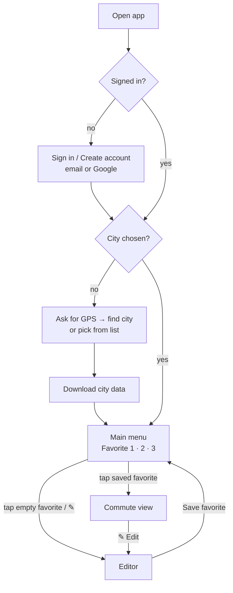
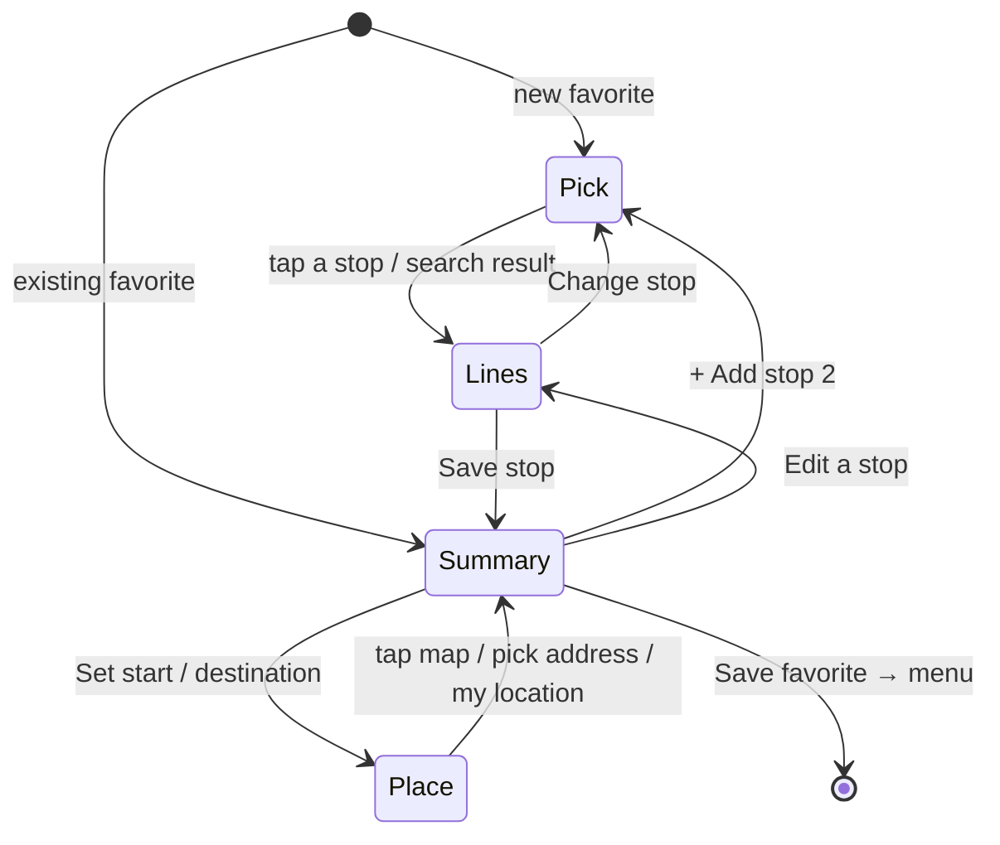

# User flows

What the user sees, screen by screen. The requirement IDs refer to [requirements.md](requirements.md).



## 1. First launch

1. **Sign in** (REQ-AUTH-1, REQ-AUTH-2). Choose *Continue with Google*, or enter an email
   and password. *Create an account* switches the form to sign-up. *Forgot password?*
   sends a reset email.
2. **Choose city** (REQ-LOC-1, REQ-LOC-2). *Use my location* asks for GPS permission. The
   app finds the metropolitan area whose box contains you. If you are outside all of them,
   or you deny GPS, you pick from the list.
3. **Download** (REQ-DATA-1). The city bundle downloads once, 0.6–3 MB depending on the
   city, and the app keeps it. Later launches skip this step until a new version is published.

Code: [views/login.js](../src/views/login.js), [views/city.js](../src/views/city.js),
[location.js](../src/location.js), [cityData.js](../src/cityData.js).

## 2. Main menu

- Three large buttons, **Favorite 1, 2, 3** (REQ-FAV-1). A saved favorite shows its name and
  stops. An empty one says *Tap to set up*.
- A **✎** button next to each opens the editor (REQ-FAV-2).
- Top right: the current city. Tap it to change city.
- Bottom: the signed-in email and *Sign out* (REQ-AUTH-3).

Code: [views/menu.js](../src/views/menu.js).

## 3. Editing a favorite

The map fills the top half. A panel below guides you through three steps.



**Pick a stop** (REQ-EDIT-1). Zoom in to see stops as white dots, then tap one. You can also
search by stop name or by the stop code printed on the sign.

**Choose lines** (REQ-EDIT-2 to REQ-EDIT-4, REQ-COMM-4, REQ-COMM-5). The panel lists **every line that serves the
stop**, each with a checkbox. **None is checked at first.** Checking a line:

- draws the whole line on the map in its own color, from its first stop to its last;
- shows up to three live buses on that line: the **next two coming to your stop** (solid,
  pulsing) and **the last one that passed it** (faded, dashed);
- adds a live line to the panel, for example *Next: 3 stops away, 9 stops away · Passed 2
  stops ago · 40s ago*.

Unchecking removes the line and its buses.

**Save stop** (REQ-EDIT-5) stores the stop with its checked lines and opens the summary.
From there, *+ Add stop 2* repeats the steps for a second stop (up to 2 per favorite).

**Summary** (REQ-FAV-4, REQ-EDIT-6). Rename the favorite. Edit or remove each stop.
*Save favorite* saves it to your account and returns to the menu. *Clear this favorite*
empties the slot.

**Start point and destination** (REQ-FAV-5, optional). The summary shows *Start point*
above the stops and *Destination* below them. *Set* opens a step where you either tap the
map, or search an address and pick a result. For the start point, *Use my current
location* is also offered. A tapped point gets a street name looked up automatically. Each
place shows on the map as a flag: green for start, checkered for destination (REQ-COMM-3).
*Remove* clears it.

Code: [views/editor.js](../src/views/editor.js), [liveLines.js](../src/liveLines.js), [geocode.js](../src/geocode.js).

## 4. Using a favorite

Tapping a saved favorite opens the **commute view** (REQ-COMM-1). It shows the same map and
bus markers as the editor, for all saved stops and lines together. Buses refresh every
30 seconds while the screen is visible (REQ-RT-2). Tap a bus for its details, or tap a stop
name to zoom to it.

**Where the map starts** (REQ-COMM-2). It zooms to fit:
- the start point and destination flags, if set;
- the chosen stops;
- for each chosen line, the stretch it drives in the **5 minutes before reaching your
  stop**. That is where the bus you are waiting for is now. The stretch uses the timetable
  ([data-pipeline.md](data-pipeline.md)), so it is short in traffic-heavy centers and longer
  on fast roads.

**How lines are drawn** (REQ-COMM-4, REQ-COMM-5):

```
   incoming (lighter, see-through)        outbound (solid)
  ░░░░░░░░░░░░░░░░░░░░░░░░░░░░░ 🚏 ███████████████████████  line 5
  ░░░░░░░░░░░░░░░░░░░░░░░░░░░░░ 🚏 ███████████████████████  line 408   ← side by side
```

Each line is split at its chosen stop. Where several lines share a street, each is drawn
slightly shifted, so all of them stay visible. A line chosen at both stops is split at the
first one.

**Map key** (REQ-COMM-6), top-left: the color, number and destination of each line, the
flags, and the bus symbols. Tap *Key* to fold it away.

**Panel** (REQ-COMM-7, REQ-COMM-8). Each stop lists its lines with a checkbox, all checked.
Uncheck a line to hide it, its buses and its key entry. This is only for this visit; the
favorite is unchanged, and the line is back next time. Scroll the panel down and the map
grows (the panel shrinks to a quarter of the screen); scroll back up to return.

Code: [views/commute.js](../src/views/commute.js), [liveLines.js](../src/liveLines.js),
[lib/routeGeometry.js](../src/lib/routeGeometry.js), [map.js](../src/map.js).

