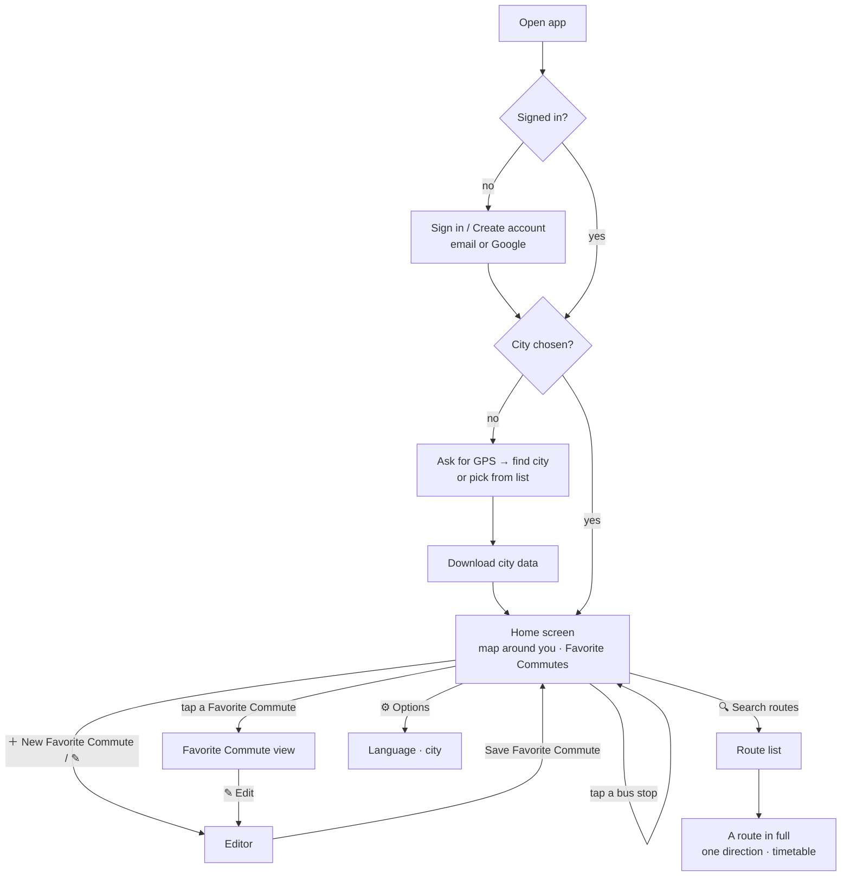
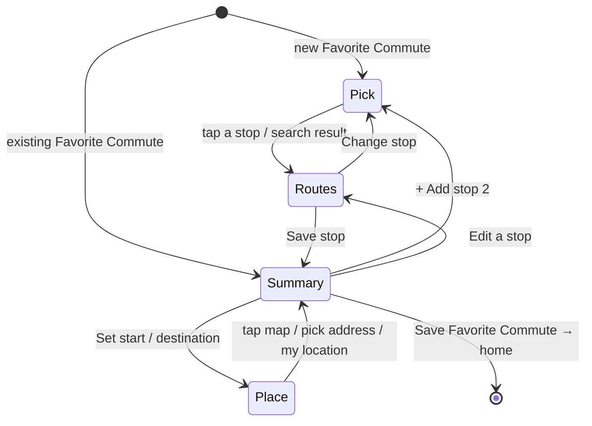

# User flows

What the user sees, screen by screen. The requirement IDs refer to [requirements.md](requirements.md).



## 1. First launch

1. **Sign in** (REQ-AUTH-1, REQ-AUTH-2). Choose *Continue with Google*, or enter an email
   and password. *Create an account* switches the form to sign-up. *Forgot password?*
   sends a reset email.
2. **Choose city** (REQ-LOC-1, REQ-LOC-2). *Use my location* asks for GPS permission. The
   app finds the metropolitan area whose box contains you. If you are outside all of them,
   or you deny GPS, you pick from the list.
3. **Download** (REQ-DATA-1). The city bundle downloads once, 0.6–3 MB depending on the
   city, and the app keeps it. Later launches skip this step until a new version is published.

Code: [views/login.js](../src/views/login.js), [views/city.js](../src/views/city.js),
[location.js](../src/location.js), [cityData.js](../src/cityData.js).

## 2. Home screen

The first screen after sign-in (REQ-HOME-1). It used to be called the main menu.

```
┌──────────────────────────────┐
│            MAP               │  centered on you (blue dot); ◎ returns to you
│   ○  ○   ○ ← bus stops       │  tap a stop → its routes + live buses
│        ◉ you                 │
├───────────── ▬ ──────────────┤  drag the handle: more map / more list
│ Knight Bus        📍 city    │
│ My Favorite Commutes         │
│ [ To work            ] [✎]   │  one button per Favorite Commute, with your name for it
│ [ Home               ] [✎]   │
│ Tap a bus stop on the map…   │
│      (＋ New Favorite Commute)│  small, bottom right, while a slot is free
│             (🔍 Search routes)│  below it: every route of the city
│                  (⚙ Options) │  below that: language, city
└──────────────────────────────┘
```

**The map** opens around your location. Until the phone has a fix, it uses the last
position remembered on this phone, or the city center. The **◎** button brings you back.

**Tap a bus stop** (REQ-HOME-2). Zoom in if no stops show. The stop is highlighted, the map
zooms to it and to where its buses are in their last ~5 minutes, and **every route through
the stop is drawn**: solid where it comes to the stop, lighter after it, side by side where
routes share a street. Live buses appear as in a Favorite Commute: the next two and the last that
passed, per route. **Tap a bus** to see everything known about it (REQ-RT-10,
[realtime.md](realtime.md#what-a-bus-tells-us)).

**Route icons** (REQ-HOME-3). The panel shows the stop first, then its routes as small
icons, several to a row: `[☑ 62] [☑ 66⚠] [☐ 189]`. Each is a checkbox and the route number
in the route's map color (⚠ = more than one stop pattern; dashed ring = weekend route).

- **The box** shows or hides the route and its buses on the map. All start checked; at a
  busy stop, the first 16.
- **The number** opens a pop-up about the route: where it goes, its operator, first and
  last stop, its live buses at this stop, *What is different?* for a route with several
  stop patterns, and **Full route: map, stops and timetable**, which opens
  [the route in full](#5-a-route-in-full).

**✕ Close** returns to the plain map.

**My Favorite Commutes** (REQ-FAV-1, REQ-FAV-2, REQ-FAV-4). Only Favorite Commutes you saved are shown, each
as a button with the **name you gave it** ("Favorite Commute N" if you gave none), its stops and
number of routes. Tap it to open the Favorite Commute; **✎** opens the editor.

**＋ New Favorite Commute**, bottom right, appears while fewer than three are saved. If a stop is
open on the map, the new Favorite Commute starts at that stop.

**🔍 Search routes** (REQ-ROUTE-1), below it, opens the [route list](#6-search-routes).
**⚙ Options** (REQ-LANG-2), below that, opens a small pop-up with the
[language](#language), *Change city* and *Privacy & usage data*.

Also in the panel: the city (tap to change), the signed-in email, *Sign out* (REQ-AUTH-3),
*Privacy & usage data*, and for admins *📊 Favorite Commutes report*. The first time, a card asks
**Help improve Knight Bus?** (REQ-ANL-3): *Share usage* or *No thanks*. Until answered,
nothing is recorded. What is recorded: [privacy.md](privacy.md).

Code: [views/home.js](../src/views/home.js), [views/options.js](../src/views/options.js),
[liveLines.js](../src/liveLines.js),
[lib/mapFit.js](../src/lib/mapFit.js), [lib/sheetDrag.js](../src/lib/sheetDrag.js).

## 3. Editing a Favorite Commute

The map fills the top half. A panel below guides you through three steps.



**Pick a stop** (REQ-EDIT-1). Zoom in to see stops as white dots, then tap one. You can also
search by stop name or by the stop code printed on the sign.

**Choose routes** (REQ-EDIT-2 to REQ-EDIT-4, REQ-COMM-4, REQ-COMM-5). The panel lists **every route that serves the
stop**, each with a checkbox. **None is checked at first.** Checking a route:

- draws the whole route on the map as a line in its own color, from its first stop to its last;
- shows up to three live buses on that route: the **next two coming to your stop** (solid,
  pulsing) and **the last one that passed it** (faded, dashed);
- adds a live status row to the panel, for example *Next: 3 stops away, 9 stops away · Passed 2
  stops ago · 40s ago*.

Unchecking removes the route and its buses.

**Save stop** (REQ-EDIT-5) stores the stop with its checked routes and opens the summary.
From there, *+ Add stop 2* repeats the steps for a second stop (up to 2 per Favorite Commute).

**Summary** (REQ-FAV-4, REQ-EDIT-6). **Name the Favorite Commute**: the name becomes the text of its
home-screen button (leave it empty for "Favorite Commute N"). Edit or remove each stop.
*Save Favorite Commute* saves it to your account and returns to the home screen. *Clear this Favorite Commute*
empties the slot.

**Start point and destination** (REQ-FAV-5, optional). The summary shows *Start point*
above the stops and *Destination* below them. *Set* opens a step where you either tap the
map, or search an address and pick a result. For the start point, *Use my current
location* is also offered. A tapped point gets a street name looked up automatically. Each
place shows on the map as a flag: green for start, checkered for destination (REQ-COMM-3).
*Remove* clears it.

Code: [views/editor.js](../src/views/editor.js), [liveLines.js](../src/liveLines.js), [geocode.js](../src/geocode.js).

## 4. Using a Favorite Commute

Tapping a Favorite Commute opens the **Favorite Commute view** (REQ-COMM-1). It shows the same map and
bus markers as the editor, for all saved stops and routes together. Buses refresh every
30 seconds while the screen is visible (REQ-RT-2). Tap a bus for its details, or tap a stop
name to zoom to it.

**Where the map starts** (REQ-COMM-2). It zooms to fit:
- the start point and destination flags, if set;
- the chosen stops;
- for each chosen route, the stretch it drives in the **5 minutes before reaching your
  stop**. That is where the bus you are waiting for is now. The stretch uses the timetable
  ([data-pipeline.md](data-pipeline.md)), so it is short in traffic-heavy centers and longer
  on fast roads.

**How routes are drawn** (REQ-COMM-4, REQ-COMM-5):

```
   incoming: where your bus comes from (solid)    outbound (lighter, see-through)
  ███████████████████████████████████ 🚏 ▒▒▒▒▒▒▒▒▒▒▒▒▒▒▒▒▒▒▒▒▒▒▒▒  route 5
  ███████████████████████████████████ 🚏 ▒▒▒▒▒▒▒▒▒▒▒▒▒▒▒▒▒▒▒▒▒▒▒▒  route 408   ← side by side
```

Each route's line is split at its chosen stop. Where several routes share a street, each line is drawn
slightly shifted, so all of them stay visible. A route chosen at both stops is split at the
first one.

**Map key** (REQ-COMM-6), top-left: the color, number and destination of each route, the
flags, and the bus symbols. Tap *Key* to fold it away.

**Panel** (REQ-COMM-7, REQ-COMM-8). Each stop lists its routes with a checkbox, all checked.
Uncheck a route to hide it, its buses and its key entry. This is only for this visit; the
Favorite Commute is unchanged, and the route is back next time.

To see more map, **drag the panel down**: either by the grey handle at its top, or by
swiping down on the list while it's scrolled to the top. Swipe up for more list. The panel
settles at small (about a fifth of the screen), half, or large.

Routes from outside the government feed, such as the weekend *Naaim BeSofash* routes, have
no live buses (REQ-RT-5), and are marked the same way everywhere (REQ-RT-6):

- in every list: a yellow **Weekend · no live tracking** tag next to the destination, and
  a dashed yellow ring around the route number;
- on the map: a **dashed** line instead of a solid one, and a dashed entry in the map key;
- under the route's name: "נעים בסופ"ש: buses on this line cannot be tracked. Runs Fri
  16:30–02:00 · Sat 09:00–17:30".

**Top of the screen** (REQ-COMM-9). In the installed iPhone app, the status bar (clock,
battery) gets a solid strip, and the map starts below it. That way the map key and zoom
buttons are never hidden or blurred under the status bar.

Code: [views/commute.js](../src/views/commute.js), [liveLines.js](../src/liveLines.js),
[lib/routeGeometry.js](../src/lib/routeGeometry.js), [lib/offsetLine.js](../src/lib/offsetLine.js),
[lib/sheetDrag.js](../src/lib/sheetDrag.js), [map.js](../src/map.js).


## Stops that share a number

At terminals, several stops carry the same stop number: one per platform, all at the same
spot on the map (81 such groups in the Tel Aviv data, for example Reading terminal 20277
with three). Each has its own routes.

- **Told apart** (REQ-STOP-1): the platform, and the floor where there is one, follow the
  number everywhere: "מסוף רדינג/רציפים · 20277 · Platform 2". Searching 20277 lists the
  three platforms as three results.
- **⚠ sign** (REQ-STOP-2) next to the stop's name. Pressing it opens:
  *"3 bus stops share the number 20277. Make sure you are at the right one."* and a list:
  each platform with the routes that stop there, the current one marked.
- On the home screen and in the editor each other platform has **Show this one**, which
  switches to it. In a Favorite Commute the pop-up only informs.
- When the data gives no platform for some of them, the pop-up says so and tells you to
  compare the route numbers with the sign at the stop.

Code: [views/stopInfo.js](../src/views/stopInfo.js), [cityData.js](../src/cityData.js).

## Routes with more than one stop pattern

About 1–2% of routes do not always drive the same way: some trips skip a street, take a
detour or continue further in the evening. Each way is a *stop pattern* (REQ-DATA-8).

**What is drawn** (REQ-LINE-1a, REQ-LINE-1b). It depends on the stop the route is opened from:

```
only ONE pattern passes your stop          SEVERAL patterns pass your stop
────────────────🚏───────────────          ────────────🚏──────┬───────────   most common pattern: normal line
(just that pattern, even if it is                              ┊· · · · ·     other pattern: dotted line, only
 not the most common one)                                                       visible where it leaves
```

**Identical paths** (REQ-LINE-1c). Two stop patterns can drive along exactly the same
streets and differ only in which stops they serve. Then there is nothing to dot: only the
full (solid) line is shown, here and on the full-route screen.

**Live buses** (REQ-RT-8) are shown where they really are, whichever stop pattern they are
driving. A bus on a less common pattern is still shown; "stops away" is counted along the
most common pattern that passes your stop.

**The ⚠ sign** (REQ-LINE-2). Every such route has a small ⚠ next to its destination, in the
home stop list, the editor and the Favorite Commute. Pressing it opens a pop-up. On screen the
patterns are called "Most common pattern" and "Other pattern" (in Hebrew: המסלול הנפוץ, מסלול חלופי).

It starts with **In short**, a summary of how the patterns differ (REQ-LINE-1d), for example:

- *Most trips (51%) follow the usual pattern: 36 stops.*
- *49% of trips skip 3 stops (…) and stop at 2 other stops (…). They leave the usual path
  for part of the way.* (or: *They drive along the same streets.*)
- *At Dizengoff/Sheinkin: only about 51% of trips stop here. The others pass without
  stopping or take another way.*

Then the patterns one by one:

- *Most common pattern: 51% of trips · 36 stops · stops here*
- *Other pattern: 49% of trips · 35 stops · does not stop here*, with *Skips: …* and *Also stops at: …*
- one sentence saying what the map shows from this stop,
- the button **Show the full route on the map**.

Pressing ⚠ inside a checkbox row does not tick the box.

## 5. A route in full

Opened from the ⚠ pop-up (REQ-LINE-3) or from [Search routes](#6-search-routes)
(REQ-ROUTE-1). Address: `#/line/<city>/<route>/<stop>`; the stop is optional.

```
┌──────────────────────────────┐
│   MAP: this direction only   │
├───────────── ▬ ──────────────┤
│ ← Back   [62]  → Ramat Gan   │
│ From Reading to Sheba · Dan  │
│ [⇄ Switch direction] [🕒 Timetable]
│ Tap a stop on the map or in the list…
│ ▸ Stops on this route (36)   │  opens the stops in order
└──────────────────────────────┘
```

- **One direction** (REQ-ROUTE-2). A bus service runs both ways; the screen shows the one
  you opened. **⇄ Switch direction** replaces it with the opposite direction (its own map,
  stops and timetable). The two are never drawn together. A circular or one-way route has
  no such button.
- **🕒 Timetable** (REQ-ROUTE-3) shows the times at the route's first stop, or at the stop
  already chosen. **Stops on this route** lists the stops of the most common pattern in
  order; tap one to choose it on the map and see its timetable.
- **Map:** the whole route. Its most common stop pattern is drawn as a solid purple line;
  each other pattern as a dotted line in its own color, unless it takes the same path as one
  already drawn (REQ-LINE-1c). All stops are shown; a stop that
  only one pattern serves has that pattern's color. The stop you came from is highlighted.
- **Panel:** the route, its operator, and the list of patterns with their share of trips and
  differences.
- **Press a stop** (REQ-LINE-4): a pop-up with its name and **Full schedule at this stop →**.
  The schedule shows in the panel: weekday tabs (today first selected) and the times by
  hour, for example `07  :00 :15 :35 :55`. Times of trips on a less common pattern have a
  dotted underline; `⁺` marks times after midnight. These are timetable times, not live.
- Weekend-service routes have no timetable; the panel says so and gives their hours.
- **← Back** returns to where you came from (switching direction does not add a step).

Code: [views/lineInfo.js](../src/views/lineInfo.js), [views/line.js](../src/views/line.js),
[lib/schedule.js](../src/lib/schedule.js), [liveLines.js](../src/liveLines.js),
[cityData.js](../src/cityData.js).

## 6. Search routes

Opened with **🔍 Search routes** on the home screen (REQ-ROUTE-1). Address: `#/routes`.

- The list holds **every route in the city's data**, weekend services included, sorted by
  number. Type a **route number** (matched from its start: `6` finds 6, 60, 62…), part of a
  **destination** or first stop, or an **operator**. An exact number comes first. At most
  60 rows are shown; the line above the list says how many match.
- **Each bus service appears once** (REQ-ROUTE-2), as *one end ⇄ other end*, with its first
  and last stop and its operator below. The first and last stop tell apart routes that
  share a number (the same number is used in different towns).
- **Tap a row** to open [the route in full](#5-a-route-in-full): its map, **⇄ Switch
  direction**, **🕒 Timetable** and its stops.

Which two routes are the two directions of one service is worked out when the city data is
built: [data-pipeline.md](data-pipeline.md#opposite-directions).

Code: [views/routes.js](../src/views/routes.js), [cityData.js](../src/cityData.js)
(`routePairs`, `searchRoutes`).

## Language

The app is in **English and Hebrew** (REQ-LANG-1).

- **Changing it** (REQ-LANG-2): home screen → **⚙ Options** → *Language* → **English** or
  **עברית**. The screen is drawn again at once in the new language. Before signing in, the
  sign-in screen has a link to the other language.
- **Remembered on this device only** (`kb.language`). On a first visit the app follows the
  phone's language: Hebrew phone → Hebrew, anything else → English.
- **Hebrew reads right to left.** The panels, lists and pop-ups turn around; the map does
  not. The home-screen buttons stay bottom right. Arrows turn with the text (← points to
  where a route goes). Clock times stay as they are (`07:45`).
- **Names from the transit data** (stops, destinations, operators) are Hebrew in both
  languages; that is how the Ministry of Transport publishes them. City names are shown in
  the app's language.

How it works: the code writes each text in English through `t('…')`; in Hebrew the text is
looked up in [i18n/he.js](../src/i18n/he.js), one line per text. `npm test` reads the code
and fails if a text has no Hebrew line, if a Hebrew line lost a `{place}` for a value, or
if a line is left over from a text the app no longer shows. To add a text: write it in
English in the code, run `npm test`, add the line it asks for.

Code: [i18n.js](../src/i18n.js), [i18n/he.js](../src/i18n/he.js),
[views/options.js](../src/views/options.js), [tests/i18n.test.mjs](../tests/i18n.test.mjs).
