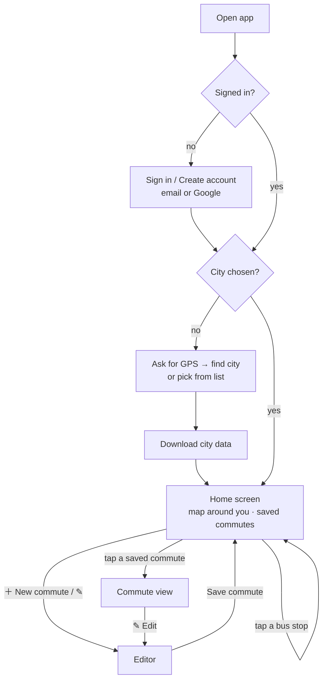
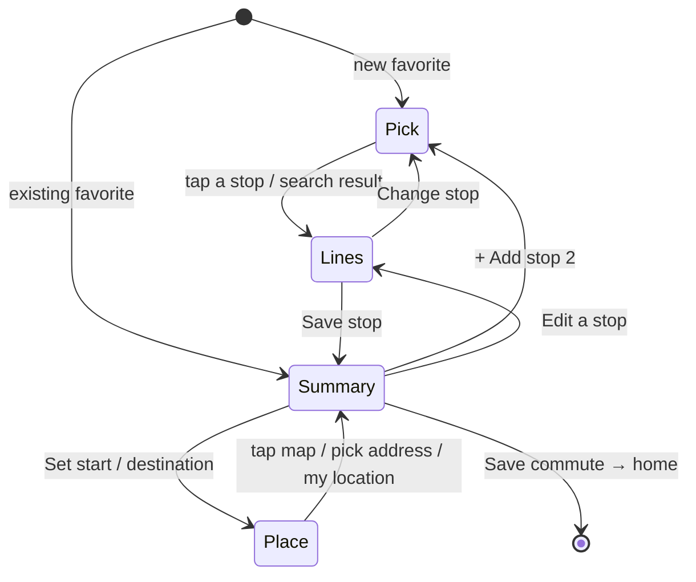

# User flows

What the user sees, screen by screen. The requirement IDs refer to [requirements.md](requirements.md).



## 1. First launch

1. **Sign in** (REQ-AUTH-1, REQ-AUTH-2). Choose *Continue with Google*, or enter an email
   and password. *Create an account* switches the form to sign-up. *Forgot password?*
   sends a reset email.
2. **Choose city** (REQ-LOC-1, REQ-LOC-2). *Use my location* asks for GPS permission. The
   app finds the metropolitan area whose box contains you. If you are outside all of them,
   or you deny GPS, you pick from the list.
3. **Download** (REQ-DATA-1). The city bundle downloads once, 0.6–3 MB depending on the
   city, and the app keeps it. Later launches skip this step until a new version is published.

Code: [views/login.js](../src/views/login.js), [views/city.js](../src/views/city.js),
[location.js](../src/location.js), [cityData.js](../src/cityData.js).

## 2. Home screen

The first screen after sign-in (REQ-HOME-1). It used to be called the main menu.

```
┌──────────────────────────────┐
│            MAP               │  centered on you (blue dot); ◎ returns to you
│   ○  ○   ○ ← bus stops       │  tap a stop → its lines + live buses
│        ◉ you                 │
├───────────── ▬ ──────────────┤  drag the handle: more map / more list
│ Knight Bus        📍 city    │
│ My commutes                  │
│ [ To work            ] [✎]   │  one button per SAVED commute, with your name for it
│ [ Home               ] [✎]   │
│ Tap a bus stop on the map…   │
│               (＋ New commute)│  small, bottom right, while a slot is free
└──────────────────────────────┘
```

**The map** opens around your location. Until the phone has a fix, it uses the last
position remembered on this phone, or the city center. The **◎** button brings you back.

**Tap a bus stop** (REQ-HOME-2). Zoom in if no stops show. The stop is highlighted, the map
zooms to it and to where its buses are in their last ~5 minutes, and **every line through
the stop is drawn**: solid where it comes to the stop, lighter after it, side by side where
lines share a street. Live buses appear as in a commute: the next two and the last that
passed, per line. The panel shows the stop first, with one row per line and its live status.

**Line checkboxes** (REQ-HOME-3). All lines start checked; at a very busy stop, the first
30. Uncheck a line to hide it and its buses. **✕ Close** returns to the plain map.

**My commutes** (REQ-FAV-1, REQ-FAV-2, REQ-FAV-4). Only commutes you saved are shown, each
as a button with the **name you gave it** ("Commute N" if you gave none), its stops and
number of lines. Tap it to open the commute; **✎** opens the editor.

**＋ New commute**, bottom right, appears while fewer than three are saved. If a stop is
open on the map, the new commute starts at that stop.

Also in the panel: the city (tap to change), the signed-in email, *Sign out* (REQ-AUTH-3),
*Privacy & usage data*, and for admins *📊 Commute report*. The first time, a card asks
**Help improve Knight Bus?** (REQ-ANL-3): *Share usage* or *No thanks*. Until answered,
nothing is recorded. What is recorded: [privacy.md](privacy.md).

Code: [views/home.js](../src/views/home.js), [liveLines.js](../src/liveLines.js),
[lib/mapFit.js](../src/lib/mapFit.js), [lib/sheetDrag.js](../src/lib/sheetDrag.js).

## 3. Editing a favorite

The map fills the top half. A panel below guides you through three steps.



**Pick a stop** (REQ-EDIT-1). Zoom in to see stops as white dots, then tap one. You can also
search by stop name or by the stop code printed on the sign.

**Choose lines** (REQ-EDIT-2 to REQ-EDIT-4, REQ-COMM-4, REQ-COMM-5). The panel lists **every line that serves the
stop**, each with a checkbox. **None is checked at first.** Checking a line:

- draws the whole line on the map in its own color, from its first stop to its last;
- shows up to three live buses on that line: the **next two coming to your stop** (solid,
  pulsing) and **the last one that passed it** (faded, dashed);
- adds a live line to the panel, for example *Next: 3 stops away, 9 stops away · Passed 2
  stops ago · 40s ago*.

Unchecking removes the line and its buses.

**Save stop** (REQ-EDIT-5) stores the stop with its checked lines and opens the summary.
From there, *+ Add stop 2* repeats the steps for a second stop (up to 2 per favorite).

**Summary** (REQ-FAV-4, REQ-EDIT-6). **Name the commute**: the name becomes the text of its
home-screen button (leave it empty for "Commute N"). Edit or remove each stop.
*Save commute* saves it to your account and returns to the home screen. *Clear this commute*
empties the slot.

**Start point and destination** (REQ-FAV-5, optional). The summary shows *Start point*
above the stops and *Destination* below them. *Set* opens a step where you either tap the
map, or search an address and pick a result. For the start point, *Use my current
location* is also offered. A tapped point gets a street name looked up automatically. Each
place shows on the map as a flag: green for start, checkered for destination (REQ-COMM-3).
*Remove* clears it.

Code: [views/editor.js](../src/views/editor.js), [liveLines.js](../src/liveLines.js), [geocode.js](../src/geocode.js).

## 4. Using a favorite

Tapping a saved favorite opens the **commute view** (REQ-COMM-1). It shows the same map and
bus markers as the editor, for all saved stops and lines together. Buses refresh every
30 seconds while the screen is visible (REQ-RT-2). Tap a bus for its details, or tap a stop
name to zoom to it.

**Where the map starts** (REQ-COMM-2). It zooms to fit:
- the start point and destination flags, if set;
- the chosen stops;
- for each chosen line, the stretch it drives in the **5 minutes before reaching your
  stop**. That is where the bus you are waiting for is now. The stretch uses the timetable
  ([data-pipeline.md](data-pipeline.md)), so it is short in traffic-heavy centers and longer
  on fast roads.

**How lines are drawn** (REQ-COMM-4, REQ-COMM-5):

```
   incoming: where your bus comes from (solid)    outbound (lighter, see-through)
  ███████████████████████████████████ 🚏 ▒▒▒▒▒▒▒▒▒▒▒▒▒▒▒▒▒▒▒▒▒▒▒▒  line 5
  ███████████████████████████████████ 🚏 ▒▒▒▒▒▒▒▒▒▒▒▒▒▒▒▒▒▒▒▒▒▒▒▒  line 408   ← side by side
```

Each line is split at its chosen stop. Where several lines share a street, each is drawn
slightly shifted, so all of them stay visible. A line chosen at both stops is split at the
first one.

**Map key** (REQ-COMM-6), top-left: the color, number and destination of each line, the
flags, and the bus symbols. Tap *Key* to fold it away.

**Panel** (REQ-COMM-7, REQ-COMM-8). Each stop lists its lines with a checkbox, all checked.
Uncheck a line to hide it, its buses and its key entry. This is only for this visit; the
saved commute is unchanged, and the line is back next time.

To see more map, **drag the panel down**: either by the grey handle at its top, or by
swiping down on the list while it's scrolled to the top. Swipe up for more list. The panel
settles at small (about a fifth of the screen), half, or large.

Lines from outside the government feed, such as the weekend *Naaim BeSofash* lines, have
no live buses (REQ-RT-5), and are marked the same way everywhere (REQ-RT-6):

- in every list: a yellow **Weekend · no live tracking** tag next to the destination, and
  a dashed yellow ring around the line number;
- on the map: a **dashed** line instead of a solid one, and a dashed entry in the map key;
- under the line: "נעים בסופ"ש: buses on this line cannot be tracked. Runs Fri
  16:30–02:00 · Sat 09:00–17:30".

**Top of the screen** (REQ-COMM-9). In the installed iPhone app, the status bar (clock,
battery) gets a solid strip, and the map starts below it. That way the map key and zoom
buttons are never hidden or blurred under the status bar.

Code: [views/commute.js](../src/views/commute.js), [liveLines.js](../src/liveLines.js),
[lib/routeGeometry.js](../src/lib/routeGeometry.js), [lib/offsetLine.js](../src/lib/offsetLine.js),
[lib/sheetDrag.js](../src/lib/sheetDrag.js), [map.js](../src/map.js).

